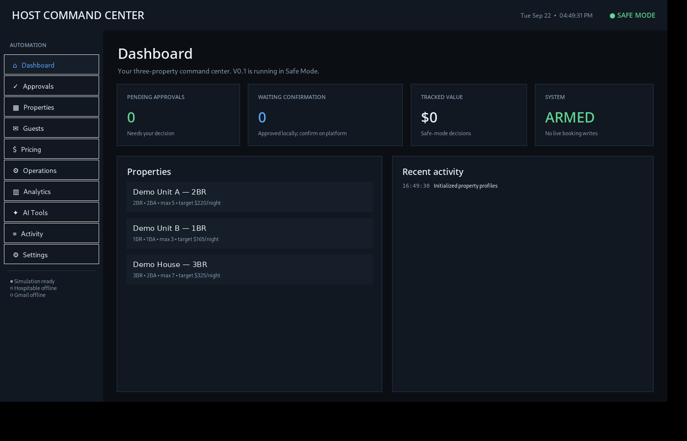
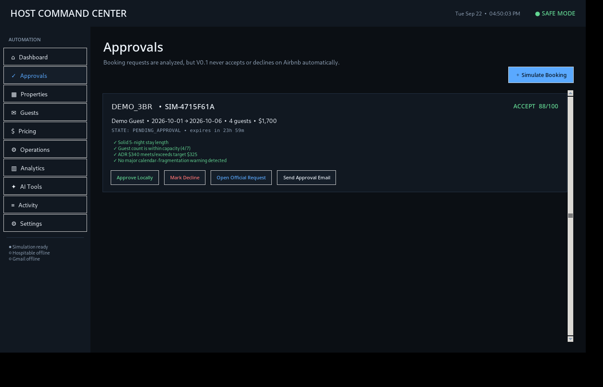

# Host Command Center

A Windows desktop app that watches a small portfolio of **Airbnb rentals** through the **Hospitable API** and **Gmail**. It scores incoming booking requests and emails the host an approve/decline card, with a strict safety model where nothing changes on Airbnb without the host.

Python + Tkinter, about **3,600 lines**, with **23 developer tests** and a **10-scenario robustness lab**.



## What it does

- **Booking reasoner:** scores each request on stay length, guest count vs capacity, nightly rate vs the property's floor/target/ceiling, and calendar fragmentation. If data is missing it forces a manual **REVIEW** instead of making something up.
- **Approval workflow:** creates one approval card per request and sends **one** deduplicated email to the host through the Gmail API (OAuth).
- **Live sync, read-only:** pulls properties, reservations and guest messages from Hospitable and reconciles status changes, with Hospitable as the source of truth.
- **Webhook trigger:** incoming webhook files trigger an immediate reconcile, and periodic polling covers anything missed.
- **Setup wizard:** a guided Gmail OAuth + Hospitable token setup, with secrets encrypted using **Windows DPAPI**.
- **Migration:** imports the database and encrypted secrets from earlier versions on first launch.



## Safety model: "Shadow Mode"

The app is **live-read + live-notify** and never writes live:

| Live | Intentionally disabled |
|---|---|
| Gmail OAuth + approval emails | Accepting or declining reservations |
| Hospitable property/reservation sync | Sending guest messages |
| Reading guest messages | Changing price or availability |
| Status reconciliation | Creating cleaning/maintenance tasks |

Disabled actions are visibly marked as unavailable. The app never fakes success. The idea is to watch real data and compare the app's decisions against the host's own before trusting it with any writes.

## Robustness lab

`robustness_lab.py` stress-tests the event engine and state machine:

- concurrent duplicate events, plus double-clicks and replays
- malformed input and missing data, which fail safe
- expired requests, and terminal-state "resurrection" attempts
- duplicate approval-email prevention
- provider source-of-truth reconciliation
- persistence across restarts

## Run it

```
setup.bat                 # one-time: venv + dependencies
run.bat                   # launch the app
self_test.bat             # quick health check
robustness_lab.bat        # stress scenarios
python -m pytest tests/   # developer tests
```

Property data in `data/properties.json` is **demo data**. Secrets, the database and mail outbox are git-ignored.

## Layout

| Path | What |
|---|---|
| `core/` | Booking reasoner, event engine, state machine, database, secret store, migration |
| `providers/` | Gmail, Hospitable, and a mock email provider for tests |
| `services/` | Approval, notification and shadow-sync services |
| `backend/` | Webhook server |
| `ui/` | Main window + setup wizard |
| `tests/` | Developer tests |

*Version notes for v0.4 are in [`docs/V0_4_NOTES.md`](docs/V0_4_NOTES.md).*

---

*© Asad Kurbonov. Shared for portfolio purposes.*
